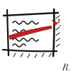
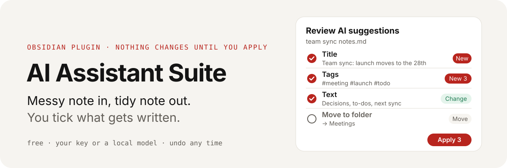
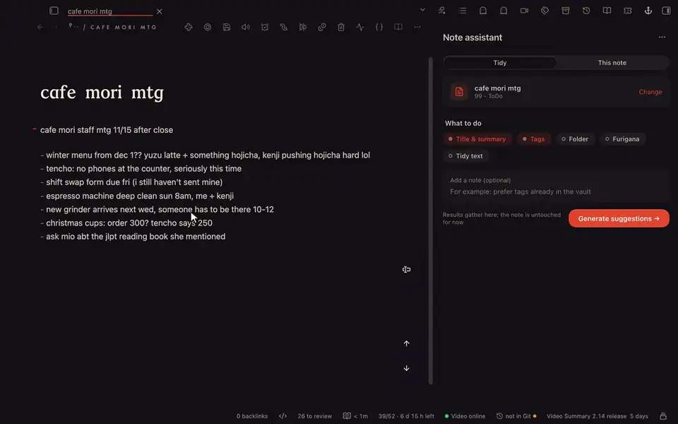
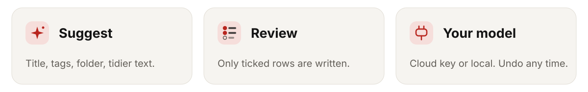
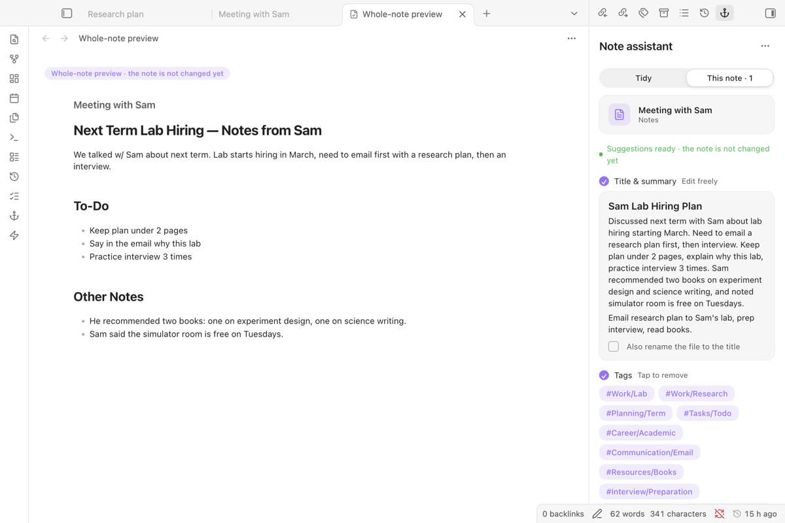
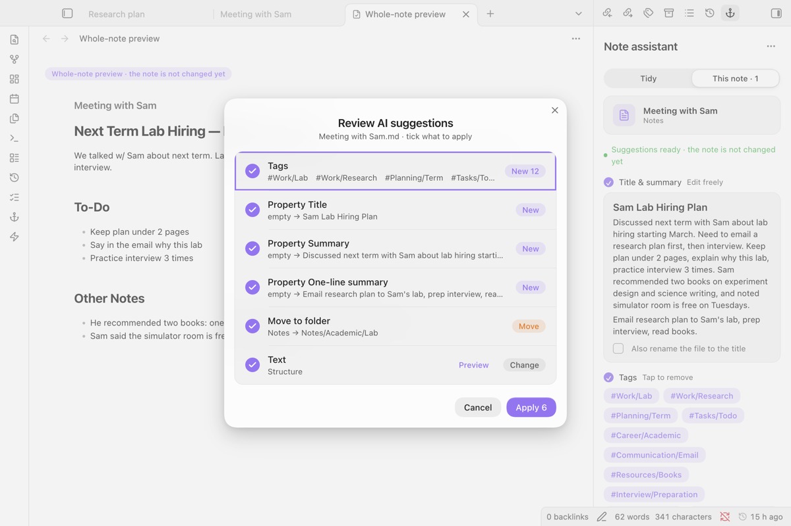
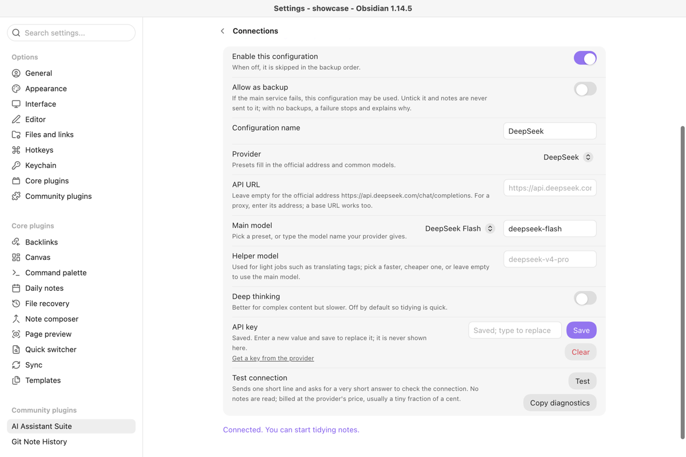

<a href="README.md">English</a> · <a href="README_zh.md">中文</a>

<picture><source media="(prefers-color-scheme: dark)" srcset="assets/readme/icon-dark.svg"></picture>

<picture>
  <source media="(prefers-color-scheme: dark)" srcset="assets/readme/hero-dark.svg">
  
</picture>

<a href="https://community.obsidian.md/plugins/ai-assistant-suite"><b>Obsidian からインストール</b></a> · <a href="https://rexxall.github.io/#ai-assistant-suite">使い方を見る</a>

<picture>
  <source media="(prefers-color-scheme: dark)" srcset="assets/readme/cards-dark.svg">
  
</picture>

## 3 ステップで始める

1. 「Settings → Community plugins → Browse」で **AI Assistant Suite** をインストールし、有効にします。
2. リボンの錨アイコンでパネルを開きます。AI の接続前でも **「Load example」** で試せます。同名のコマンドもあります。用意済みの提案が付いたデモノートで、項目の選択、適用、取り消しを試せます。通信も料金も発生しません。
3. 自分のノートを処理するには、「Settings → AI Assistant Suite → Connections」でプロバイダーを選びます。初期設定は DeepSeek です。キーを選ぶか新規作成し、推奨モデルのまま **「Test」** を押します。ノートを開き、処理したい項目を選んで **「Generate suggestions」** を押します。

**動作環境** Obsidian <!-- DOCS-SYNC:START min -->1.13<!-- DOCS-SYNC:END --> 以降のデスクトップまたはモバイルと、API キーかローカルモデルが必要です。**費用** プラグインは無料です。モデルの料金は選んだプロバイダーに使用量に応じて支払います。ローカルモデルには API 利用料がかかりません。

うまく動かないときは、[AI アシスタントに貼る確認用プロンプト](docs/troubleshooting.ja.md)をどうぞ。

## その他

<b>使い方</b>

開いているノートについて、タイトル、要約、タグ、保存先フォルダー、整理した本文を AI に提案させます。提案は確認リストに並びます。チェックして適用するまでノートは変わりません。適用した変更は元に戻せます。

1. タイトルと要約、タグ、フォルダー、本文の整理、日本語のふりがな、カスタムアクションから選びます。
2. 提案は「This note」に表示されます。整理した本文は、ノート全体のプレビューで確認できます。
3. **「Review and apply」** で確認リストを開きます。チェックした項目だけを書き込みます。確認中にノートが編集されていた場合は、何も書き込まず、再生成を求めます。
4. 適用した変更はノートごとに取り消せます。フォルダーを一括処理した場合も、結果はノートごとに確認します。

*左側は書き込み前のプレビューです。右側の提案は編集や削除ができます。*

<b>必要なものと費用</b>

- **動作環境：** Obsidian <!-- DOCS-SYNC:START min -->1.13<!-- DOCS-SYNC:END --> 以降のデスクトップまたはモバイルと、モデルの API キーか、コンピューター上のローカルモデル（Ollama、LM Studio）が必要です。
- **プラグイン：** 無料のオープンソースです（MIT）。開発者側のアカウント登録やサブスクリプションは不要です。利用状況の収集もありません。
- **モデル：** 選んだプロバイダーの従量課金です。ローカルモデルには API 利用料がかかりません。無料枠や新規登録時のクレジットがあるサービスもあります。料金は変わるため、各社の料金ページで確認してください。**「Test」** は短い文を一つ送り、短い返答を求めます。通常の費用は 1 セントを大きく下回ります。

<b>データの送信先と保存先</b>

| 項目 | 内容 |
|---|---|
| **送信する内容** | 処理を開始したノートまたは選択範囲の本文と、その処理の指示を送ります。タグやフォルダーの提案には、保管庫内の既存のタグ名とフォルダー名も送ります。処理を開始するまで送信しません。 |
| **送信先** | 有効な接続設定のうち、先頭のものを使います。失敗した場合は「Allow as backup」を有効にした設定だけを試します。初期状態では無効です。予備の設定がなければ停止し、理由を表示します。一括処理の前には、送るノート数、文字数、送信先を表示します。クラウド接続を予備に指定せずローカルモデルだけを使う場合、内容はコンピューターの外に出ません。 |
| **キーの保存先** | この端末の Obsidian のキーチェーン（「Settings → Keychain」）です。プラグインの設定ファイルには `deepseek-api-key` などのキー名だけを保存します。同じ名前を使う他のプラグインからも選べます。キーは対応するプロバイダーにだけ送信します。「Copy diagnostics」にはキー、完全な接続先 URL、ノート本文を含めません。 |
| **別の端末** | キーは保管庫と一緒には同期されません。別の端末では接続設定を開き、キーを選ぶか新規作成してください。 |
| **その他** | 提案、取り消し用のスナップショット、処理履歴はプラグインのデータに保存します。利用状況は送信しません。 |

<b>プロバイダー</b>

| プロバイダー | 既定の接続先 | プリセットのモデル |
|---|---|---|
| DeepSeek（初期設定） | `https://api.deepseek.com/chat/completions` | deepseek-flash、deepseek-v4-pro |
| Qwen（Alibaba Cloud Model Studio） | `https://dashscope.aliyuncs.com/compatible-mode/v1/chat/completions` | qwen-plus、qwen-max、qwen-flash |
| SiliconFlow | `https://api.siliconflow.cn/v1/chat/completions` | DeepSeek V4 Flash、Qwen3 32B |
| Kimi（Moonshot AI） | `https://api.moonshot.cn/v1/chat/completions` | kimi-k3、kimi-k2.6 |
| Zhipu GLM | `https://open.bigmodel.cn/api/paas/v4/chat/completions` | glm-5.3、glm-5.3-flash |
| ローカルモデル | `http://localhost:11434/v1/chat/completions`（Ollama。LM Studio は通常ポート 1234） | ダウンロードしたモデル |
| Google Gemini | Google の API | gemini-2.5-flash、gemini-2.5-pro |
| カスタム（OpenAI 互換） | 入力した完全な接続先 URL | 任意 |

接続先を空欄にすると公式のアドレスを使います。`https://api.deepseek.com` のようなベース URL やプロキシも指定できます。モデル一覧は入力用の選択肢です。モデル名を直接入力することもできます。

<b>言語とテーマ</b>

エラーや空の状態を含め、画面の言語は Obsidian の設定に従います。中国語の設定では中国語、それ以外では英語です。モデルに送るプロンプトは設定で編集できます。

色はテーマの変数を使います。スタイルはプラグインのビュー内にだけ適用します。

<b>制限</b>

- 提案の品質はモデルに左右されます。特に本文の書き換えは、適用前に確認してください。
- 一括処理ではノートごとにリクエストを送ります。フォルダーが大きいほど費用も増えます。
- 回答は逐次表示されません。Obsidian の `requestUrl` を使うため、モバイルでも動作し、CORS の制限を受けませんが、回答全体を受信してから表示します。既存のテストでは、DeepSeek Flash で 1 万文字のノートを整理するのに約 48 秒かかりました。
- スマートフォンの既定の `localhost` アドレスからは、コンピューター上のモデルに接続できません。

<b>開発とリリースの検証</b>

チェック項目と問題の報告方法は [CONTRIBUTING.md](CONTRIBUTING.md)、変更履歴は [CHANGELOG.md](CHANGELOG.md) を参照してください。

1.7.1 以降のリリースファイルには GitHub のビルド証明が付いています。`gh attestation verify main.js -R Rexxall/obsidian-ai-assistant-suite` で検証できます。

MIT ライセンス
