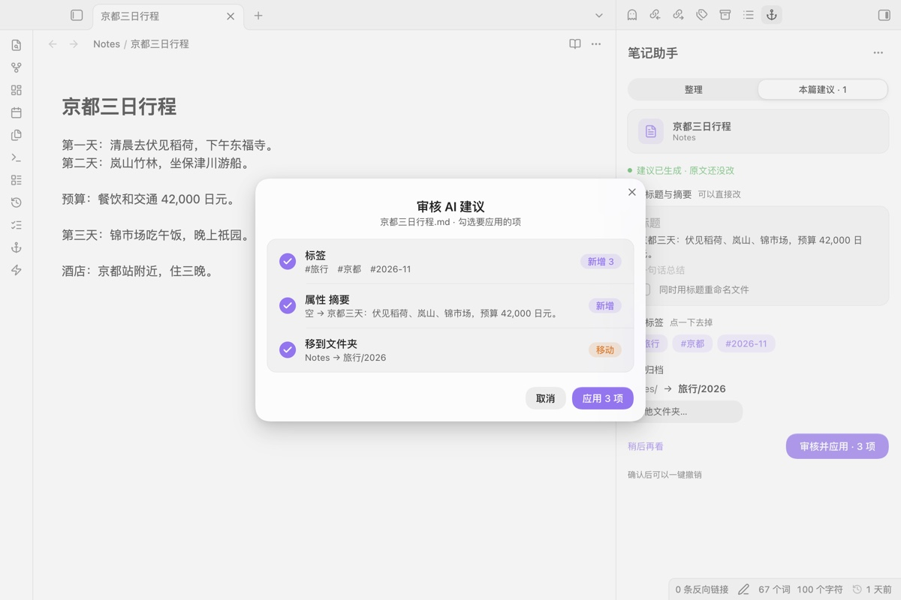
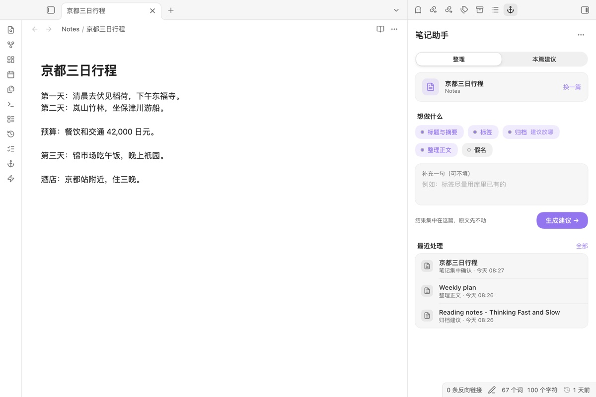

# AI Assistant Suite

**An AI that proposes; a person who decides.**

An Obsidian plugin that lets an AI suggest changes to a note — tags, properties, structure, the folder it belongs in, furigana for Japanese — and shows them for review. Nothing is written until you accept it.

一个 Obsidian 插件：AI 只负责**提议**（标签、属性、结构、该放哪个文件夹、日文假名），改不改由人决定。可以用云端 API，也可以用电脑上的本地模型（Ollama、LM Studio），笔记不出电脑。

<picture>
  <source media="(prefers-color-scheme: dark)" srcset="docs/screenshots/review-dark.jpg">
  
</picture>

## The problem

My notes grew faster than I could tidy them: inconsistent tags, no summaries, notes in the wrong folder. Doing it by hand was slow; letting an AI rewrite notes directly was risky, because it could silently change what I wrote.

笔记越来越多，标签不统一、没有摘要、放错文件夹。手工整理太慢，直接让 AI 改又怕它悄悄改掉我写的内容。

## How it works

<picture>
  <source media="(prefers-color-scheme: dark)" srcset="docs/screenshots/sidebar-dark.jpg">
  
</picture>

1. Open a note, open the assistant in the right sidebar, choose what you want done: tidy the structure, add properties, suggest tags, suggest a folder, add furigana, or a custom action.
2. The AI returns one proposal for this note and opens a **checklist**: tags, each property, the folder move and the body text each get a row with a *New / Changed / Move* label. Untick any row you do not want; the body text can be previewed as the whole note.
3. **Apply N items** writes only what you kept. If the note changed while you were reviewing, the write stops and asks you to regenerate. Every applied change can be undone.
4. For a folder, run a batch: results are reviewed **one note at a time**, then the next.

**Looks:** an Apple-style "glass" interface: the sidebar, cards and previews are solid, only the sidebar header and dialogs are translucent. Colours come from your Obsidian theme and accent colour, light and dark follow Obsidian, and *Reduce transparency* / *Reduce motion* in the system settings are respected.

## Design choices

| Choice | Why | Cost |
|---|---|---|
| AI results go to a review panel, never straight into the note | The person keeps the final say | One extra click per change |
| Full-document preview is the default view | Comparing changes line by line did not show how the whole note would look | Long notes take more screen space |
| Folder and tag suggestions come as several options | Filing is a judgement call; the AI offers candidates, the person picks | The AI's top choice is not applied automatically |
| Batch results are grouped per note, one note at a time | Batch runs produced many scattered result cards | Reviewing a whole batch still takes time |
| Before writing, the note is compared with the version the AI saw | If the note changed meanwhile, the write stops instead of overwriting new text | The user may need to regenerate |
| Undo / redo for every applied change | Mistakes are cheap to reverse | Snapshots are stored in plugin data |
| Several API configurations with automatic fallback; the one that answered last is tried first; every request has a timeout | One provider being down or silent should not block the work | The same note may be sent to a second provider; the plugin shows a notice when that happens |
| A local model (Ollama, LM Studio) is a first-class provider | Private notes can be tidied without leaving the computer | Local models are slower and less consistent than large cloud models |
| *Only existing tags* filters the model's answer against the vault's tags | A settled tag system should not grow new tags by accident | The model may find fewer tags |
| Before a batch, the plugin says how much text goes where | Batch runs send many notes at once; the person should know where they go | One more line to read |

## Install

1. Install **AI Assistant Suite** from *Settings → Community plugins → Browse*, or download `main.js`, `manifest.json` and `styles.css` from the latest release into `<vault>/<config folder>/plugins/ai-assistant-suite/` (the config folder is `.obsidian` unless you changed it).
2. Enable it in *Settings → Community plugins*.
3. In the plugin settings, add at least one configuration: provider (OpenAI-compatible, DeepSeek, Google Gemini, or a local model through Ollama or LM Studio), key if the provider needs one, and model. Test the connection from the settings page.

Works on desktop and mobile (a local model on your computer is not reachable from the phone). No build step: `main.js` is the source.

### Local model in two minutes

1. Install [Ollama](https://ollama.com) and run `ollama pull qwen3:8b` (or any chat model).
2. In the plugin settings choose **本地模型（Ollama、LM Studio）** (local model), leave the address empty (Ollama's `http://localhost:11434/v1/chat/completions` is used), type the model name, test the connection.

LM Studio's server usually listens on `http://localhost:1234/v1/chat/completions`.

## Two-minute demo

Use a test vault, not your daily vault.

1. Open a messy note → in the sidebar choose **Suggest tags** and **Add properties** → **Generate**.
2. The proposal appears as a full-note preview; untick one suggestion and apply the rest.
3. Edit the note, then try to apply the old proposal again → the plugin refuses and asks you to regenerate.
4. Undo the last applied change.
5. Run a batch on a folder → review the results note by note.

## Privacy and network use

The plugin needs an AI model to do anything. It talks only to the services you configure:

| Provider | Address | Needs an account |
|---|---|---|
| OpenAI-compatible | the URL you enter (OpenAI, OpenRouter, a proxy, ...) | yes, usually paid |
| DeepSeek | `https://api.deepseek.com` (or your URL) | yes, paid |
| Google Gemini | `https://generativelanguage.googleapis.com` | yes, free tier available |
| Local model | `http://localhost:11434` (Ollama) or the URL you enter | no; nothing leaves the computer |

| What | Where it goes |
|---|---|
| Note text you ask the AI about | Sent to the provider of the first working configuration, and only when you start an action; if it fails, to the next enabled configuration (a notice says so). Before a batch, the plugin shows how many notes and how much text will be sent, and where |
| API keys | Stored in this vault's plugin data (`data.json`), obfuscated, never sent anywhere except the provider they belong to |
| Proposals, undo snapshots, processing history | This vault's plugin data |
| Anything else | Nothing is sent; there is no telemetry |

Do not commit `data.json` to Git.

## Limits

- Suggestions are only as good as the model and the prompt; review them.
- Batch runs send one request per note; large folders cost accordingly.
- The key obfuscation in `data.json` protects against casual reading, not against someone with access to the file.
- The interface is in Chinese; command names follow Obsidian's language (Chinese or English).
- Streaming answers use `fetch`, because Obsidian's `requestUrl` cannot stream. If a provider rejects browser requests, the plugin falls back to one normal request.

## Development

```bash
node --check main.js
for t in *.test.cjs; do node "$t"; done
```

The tests cover guarded writes, partial acceptance, full-document preview, per-note review, DeepSeek and local-model requests, request timeouts, the streaming fallback, fallback order, the only-existing-tags filter and the batch send summary. They run without Obsidian by loading `main.js` in a sandbox with stub classes. Design notes are in [docs/](docs/); versions are in [CHANGELOG.md](CHANGELOG.md).

## License

MIT
