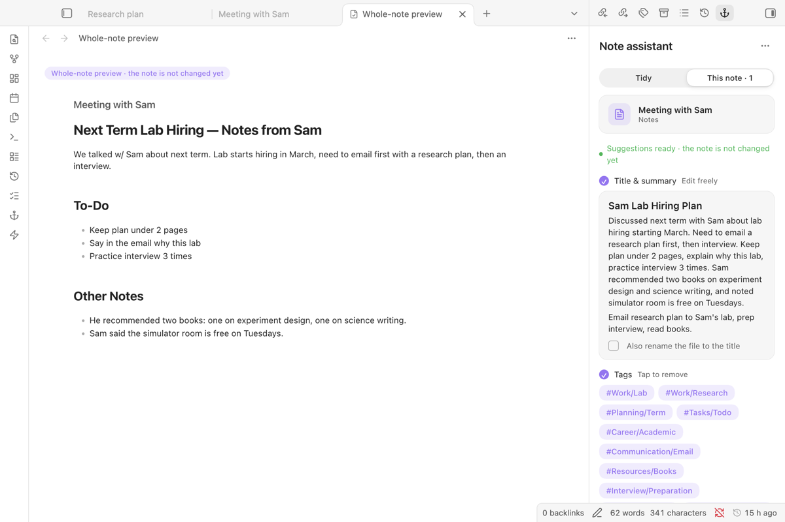
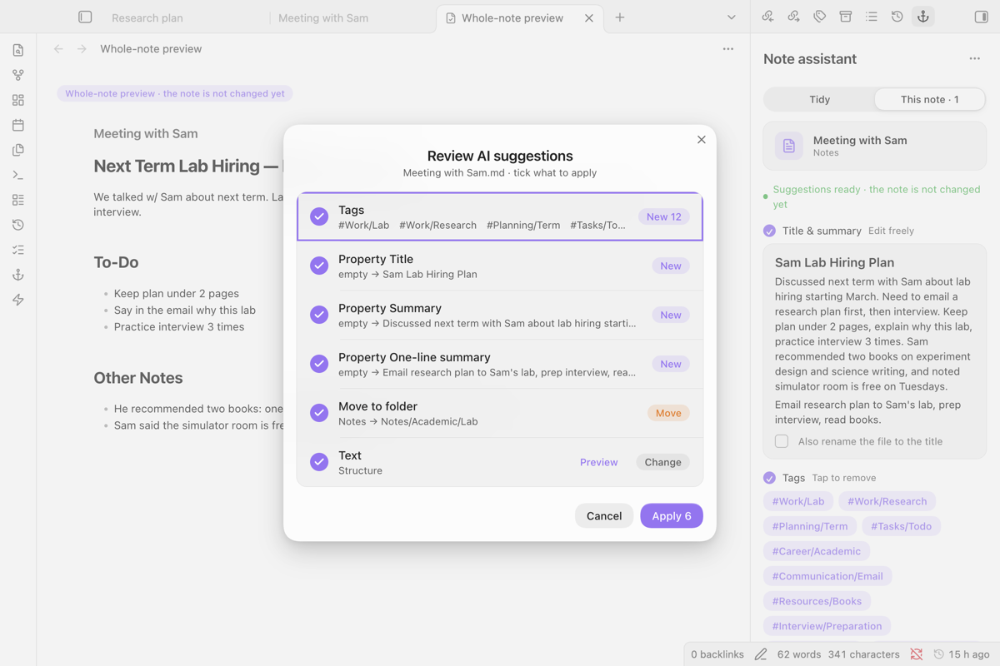
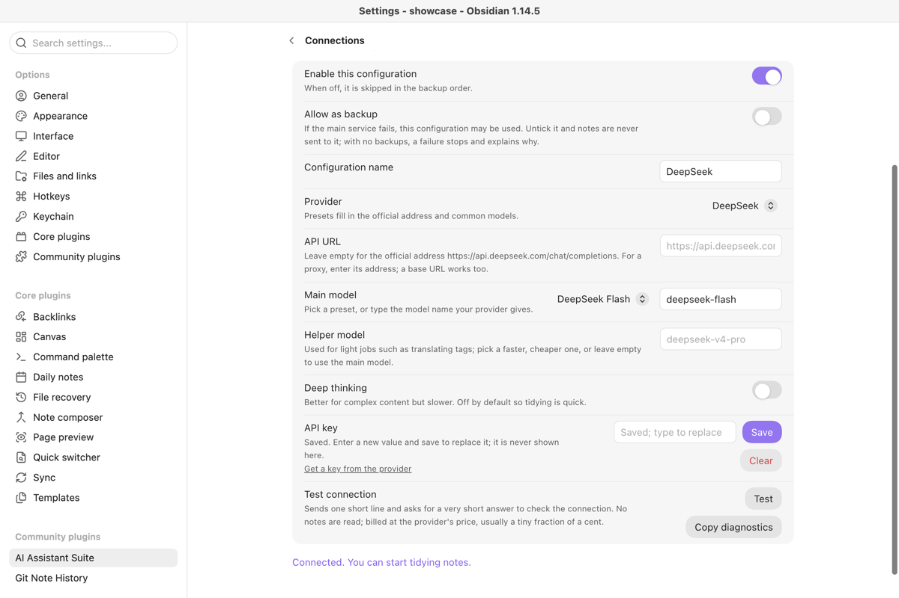

# AI Assistant Suite

[中文说明](README_zh.md)

Ask an AI to suggest a title, summary, tags, a folder and tidier text for the note you are on. Every suggestion lands in a review list; nothing is written until you tick it and apply, and every change can be undone.

*Left: the tidied note, not written yet. Right: suggestions you can edit or remove.*

## Start here

1. Install **AI Assistant Suite** from *Settings → Community plugins → Browse* and enable it.
2. Open the assistant (anchor icon in the ribbon). Not connected yet? Click **Load example** (also a command): a demo note with pre-written suggestions, no network and no cost, so you can try ticking, applying and undoing.
3. To use your own notes, open *Settings → AI Assistant Suite → Connections*: choose a provider (DeepSeek is preselected), paste a key, keep the suggested model, and press **Test**.
4. Open a note, pick what you want done and choose **Generate suggestions**.

## What it needs and what it costs

- **Needs:** Obsidian 1.13 or later, desktop or mobile, and either an API key from a model provider or a local model (Ollama, LM Studio) on your computer.
- **The plugin:** free and open source (MIT). No account with the author, no subscription, no telemetry.
- **The model:** paid to the provider you choose, by usage. A local model costs nothing. Some providers have free tiers or new-user credit; check their own pricing pages, which change often. **Test** sends one short line and asks for a very short answer, usually a tiny fraction of a cent.

## More pictures

## Where your data goes

| | |
|---|---|
| **What is sent** | The text of the note (or selection) you start an action on, plus the instructions for that action. For tag and folder suggestions, the names of your existing tags and folders are sent too. Nothing is sent until you start an action. |
| **Who gets it** | Only the first enabled configuration. If it fails, only configurations you ticked as *Allow as backup* (off by default); with none ticked, the action stops and says why. Before a batch, the plugin shows how many notes and how much text go to which services. A local model keeps everything on your computer as long as no cloud configuration is ticked as a backup. |
| **Where the key is stored** | Encrypted in this vault's plugin data (`.obsidian/plugins/ai-assistant-suite/data.json`). It is sent only to the provider it belongs to and never shown again in settings. *Copy diagnostics* contains no key, no full address and no note text. |
| **Other devices** | The key travels with the vault: if you sync the vault (Obsidian Sync, iCloud, Git), the other device can use it without re-entering it. If you do not want that, keep `data.json` out of the sync and enter the key on each device. Do not commit `data.json` to a public repository. |
| **Anything else** | Suggestions, undo snapshots and history stay in plugin data. No telemetry. |

The encryption protects against casual reading of the file, not against someone who has the file and the plugin.

## Providers

| Provider | Default address | Models offered |
|---|---|---|
| DeepSeek (default) | `https://api.deepseek.com/chat/completions` | deepseek-flash, deepseek-v4-pro |
| Qwen (Alibaba Cloud Model Studio) | `https://dashscope.aliyuncs.com/compatible-mode/v1/chat/completions` | qwen-plus, qwen-max, qwen-flash |
| SiliconFlow | `https://api.siliconflow.cn/v1/chat/completions` | DeepSeek V4 Flash, Qwen3 32B |
| Kimi (Moonshot AI) | `https://api.moonshot.cn/v1/chat/completions` | kimi-k3, kimi-k2.6 |
| Zhipu GLM | `https://open.bigmodel.cn/api/paas/v4/chat/completions` | glm-5.3, glm-5.3-flash |
| Local model | `http://localhost:11434/v1/chat/completions` (Ollama; LM Studio is usually port 1234) | any model you pulled |
| Google Gemini | Google's API | gemini-2.5-flash, gemini-2.5-pro |
| Custom (OpenAI-compatible) | the full address you enter | any |

Leave the address empty to use the official one; a base URL such as `https://api.deepseek.com` or a proxy also works. The model list is a shortcut; you can type any model name.

## How it works

1. Choose what you want for the open note: title and summary, tags, folder, tidy text, furigana for Japanese, or a custom action.
2. The suggestions appear under *This note*. The tidied text opens as a whole-note preview.
3. **Review and apply** opens the checklist. Only ticked rows are written; if the note changed while you were reviewing, nothing is written and you are asked to generate again.
4. Every applied note can be undone. For a folder, run a batch and review the results one note at a time.

## Language and themes

Every part of the interface, including errors and empty states, follows Obsidian's language: Chinese, or English for every other language. The prompts sent to the model are editable in settings.

Colours come from your theme's variables and the styles apply only inside the plugin's views.

## Limits

- Suggestions are only as good as the model; review them, especially text rewrites.
- Batch runs send one request per note; large folders cost accordingly.
- Answers do not stream: requests use Obsidian's `requestUrl`, which works on mobile and is not blocked by CORS but returns the whole answer at once. In testing, tidying a 10,000-character note with DeepSeek Flash took about 48 seconds.
- A local model on your computer cannot be reached from a phone.

## License

MIT
