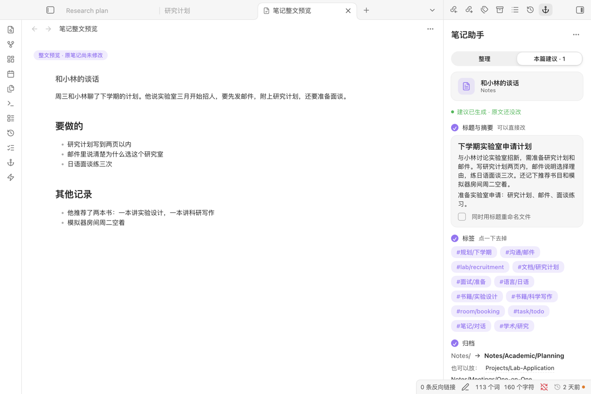
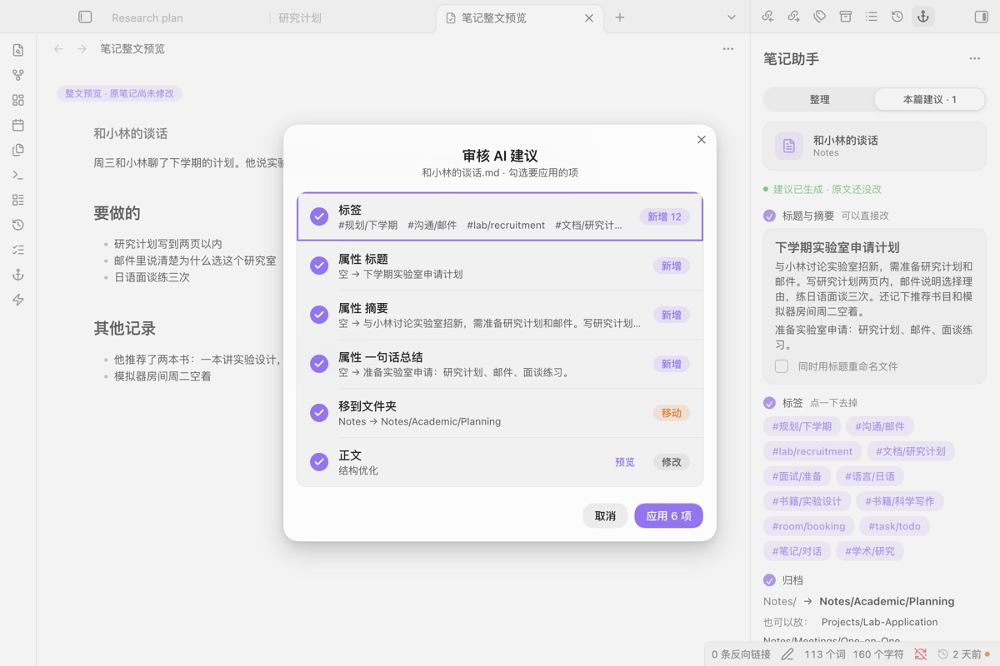
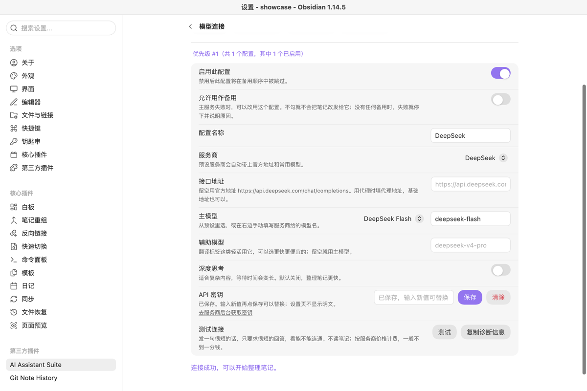

# AI Assistant Suite

[English](README.md)

让 AI 给当前这篇笔记建议标题、摘要、标签、该放的文件夹和整理后的正文。所有建议先进审阅清单，你勾选并点应用之前一个字都不改，改完也能撤销。

*左边：整理后的笔记，还没写入。右边：每条建议都能改或去掉。*

## 从这里开始

1. 在“设置 → 第三方插件 → 浏览”里搜索 **AI Assistant Suite**，安装并启用。
2. 点左侧功能区的锚形图标打开助手。还没连 AI？点“载入示例”（也有同名命令）：一篇演示笔记配上预先写好的建议，不联网、不花钱，可以照常试勾选、应用和撤销。
3. 要处理自己的笔记，打开“设置 → AI Assistant Suite → 模型连接”：选服务商（默认 DeepSeek），粘贴密钥，模型用推荐的就行，点“测试”。
4. 打开一篇笔记，选好要做的事，点“生成建议”。

## 需要什么，花多少钱

- **需要：** Obsidian 1.13 或更新，电脑和手机都能用；再准备一个模型服务商的 API 密钥，或者电脑上的本地模型（Ollama、LM Studio）。
- **插件费用：** 免费开源（MIT）。不用注册作者的账号，没有订阅，没有统计上报。
- **模型费用：** 按用量付给你选的服务商。本地模型不花钱。有的服务商有免费额度或新用户赠送额度，以它们官网的价格页为准，价格经常变。“测试”只发一句很短的话、要一个很短的回答，一般不到一分钱。

## 更多截图

## 数据去哪里

| | |
|---|---|
| **发送什么** | 你开始处理的那篇笔记（或选中的文字）的正文，加上这项操作的指令。建议标签和文件夹时，还会发送库里已有的标签名和文件夹名。不点开始就什么都不发。 |
| **发给谁** | 只发给排在最前面的已启用配置。它失败时，只改用你勾了“允许用作备用”的配置（默认不勾）；一个都没勾，就停下并说明原因。批量处理前会先列出几篇笔记、多少文字、发给哪些服务。只用本地模型、又没有把云服务勾作备用时，内容不出电脑。 |
| **密钥存在哪** | 加密后存在这个库的插件数据里（`.obsidian/plugins/ai-assistant-suite/data.json`）。只发给它所属的服务商，设置页里不再显示明文。“复制诊断信息”不含密钥、完整地址和笔记正文。 |
| **换设备要不要重填** | 密钥跟着库走：库用 Obsidian Sync、iCloud 或 Git 同步时，另一台设备不用重填就能用。不想这样，就把 `data.json` 排除在同步之外，每台设备各填一次。不要把 `data.json` 提交到公开仓库。 |
| **其他** | 建议、撤销快照和处理记录存在插件数据里。没有统计上报。 |

加密只防随手打开文件看到，防不住同时拿到这个文件和插件的人。

## 服务商

| 服务商 | 默认地址 | 预设模型 |
|---|---|---|
| DeepSeek（默认） | `https://api.deepseek.com/chat/completions` | deepseek-flash、deepseek-v4-pro |
| 通义千问（阿里云百炼） | `https://dashscope.aliyuncs.com/compatible-mode/v1/chat/completions` | qwen-plus、qwen-max、qwen-flash |
| 硅基流动 | `https://api.siliconflow.cn/v1/chat/completions` | DeepSeek V4 Flash、Qwen3 32B |
| Kimi（月之暗面） | `https://api.moonshot.cn/v1/chat/completions` | kimi-k3、kimi-k2.6 |
| 智谱 GLM | `https://open.bigmodel.cn/api/paas/v4/chat/completions` | glm-5.3、glm-5.3-flash |
| 本地模型 | `http://localhost:11434/v1/chat/completions`（Ollama；LM Studio 一般是 1234 端口） | 你下载的任何模型 |
| Google Gemini | Google 的接口 | gemini-2.5-flash、gemini-2.5-pro |
| 自定义（OpenAI 兼容格式） | 你填的完整地址 | 任意 |

地址留空就用官方地址；也可以填基础地址（如 `https://api.deepseek.com`）或代理地址。预设模型只是快捷选项，任何模型名都能手动填。

## 怎么用

1. 对打开的笔记选要做的事：标题与摘要、标签、归档、整理正文、日文假名，或自定义动作。
2. 建议出现在“本篇建议”里。整理后的正文以整篇预览打开。
3. “审核并应用”打开清单，只写入勾选的行；你审阅期间笔记被改过，就一个字都不写，请你重新生成。
4. 每篇应用过的笔记都能撤销。批量处理一个文件夹时，结果按笔记一篇一篇确认。

## 语言和主题

整个界面（包括错误提示和空状态）跟随 Obsidian 的语言：中文，其他语言一律用英文。发给模型的提示词可以在设置里改。

颜色取自主题变量，样式只作用在插件自己的视图里。

## 限制

- 建议的质量取决于模型，尤其是改写正文，应用前要看。
- 批量处理每篇笔记发一次请求，文件夹大，费用就相应多。
- 回答不是逐字显示的：请求走 Obsidian 的 `requestUrl`，手机能用、不受跨域限制，但回答要整段到齐才显示。测试中用 DeepSeek Flash 整理一篇 10000 字的笔记约 48 秒。
- 手机访问不到电脑上的本地模型。

## 许可

MIT
